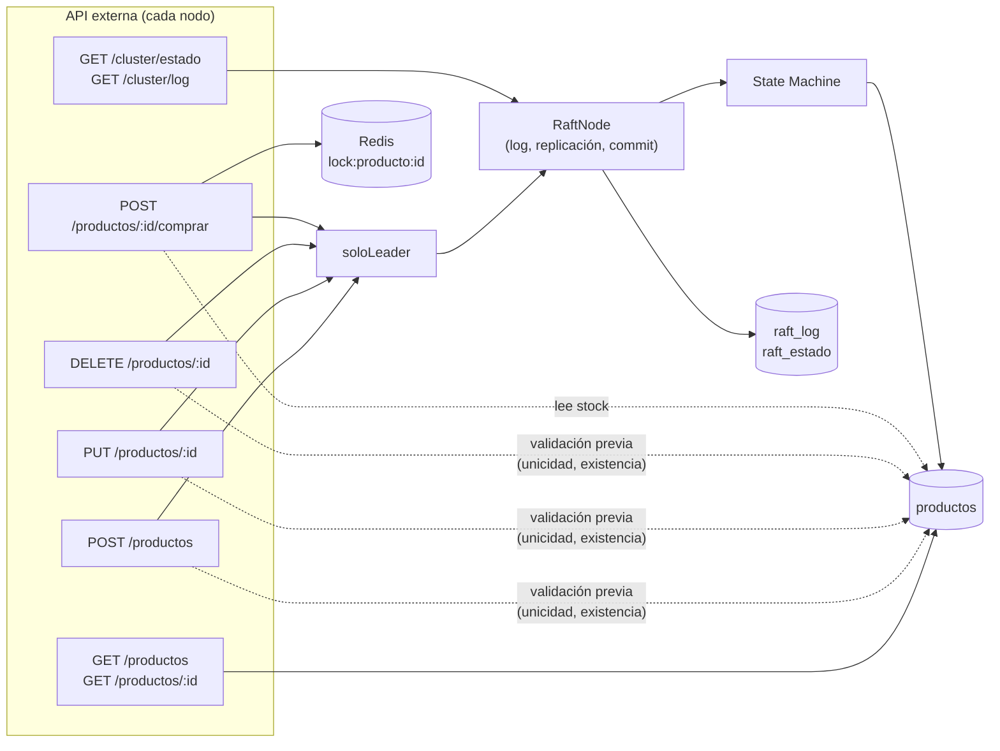

# 1. Inventario de la aplicación existente

**Versión relevada:** `app-base/`, la que quedará marcada con el tag `tp5-base`. Es el
mismo código que el commit `d497876` (TP4 de Santiago Vicente), solo trasladado a
`app-base/`.

**Cómo se relevó:** se siguió cada endpoint por todo su recorrido (ruta → middleware →
controlador → Raft → State Machine → MongoDB) y se anotaron las reglas, los datos que
lee y escribe y sus dependencias. Además, cada endpoint y cada regla se probaron contra
un cluster local de 3 nodos levantado desde un clon limpio del repositorio.

## Vista general

La aplicación es **una sola base de código** (un monolito replicado). Cada nodo del
cluster (`nodo1`, `nodo2` y `nodo3`) ejecuta el mismo proceso Node.js/Express, con dos
servidores HTTP:

| Servidor | Puertos | Para qué |
|---|---|---|
| API externa | HTTP 3001–3003 · HTTPS 3441–3443 | Negocio (productos) y diagnóstico del cluster. Swagger en `/api-docs` |
| RPC interno de Raft | HTTP 4001–4003 | Comunicación entre nodos (elección y replicación). Swagger en `/raft-docs` |

Capas por las que pasa una petición:

```
routes/  →  middlewares/soloLeader (solo escrituras)  →  controllers/productos.controller
                                                            │
                     lecturas: directo a Mongo  ◄───────────┤
                                                            ▼ escrituras
                                     raft/raftNode.proponer()  →  replicación a los peers
                                                            ▼ commit por mayoría (2/3)
                                     raft/stateMachine.aplicar()  →  models/Producto  →  MongoDB del nodo
```

Servicios externos que usa: **MongoDB** (una base por nodo en el mismo servidor) y
**Redis/Memurai** (solo para el lock de la compra).

## 1.1 Recursos y entidades principales

| Entidad | Descripción | Atributos principales | Dónde se persiste |
|---|---|---|---|
| **Producto** | Artículo del catálogo, con su precio y su stock disponible. Es la única entidad de negocio | `_id` (ObjectId), `nombre` (único), `precio`, `stock`, `categoria`, `version`, `ultimoIndiceRaft`, `createdAt`, `updatedAt` | Colección `productos` de la base de cada nodo (`tp4_nodo1`, `tp4_nodo2`, `tp4_nodo3`) |
| **Categoría** | No es una entidad: es una lista fija de valores posibles para `producto.categoria` | `periferico`, `monitor`, `accesorio`, `otro` | Escrita en el código (`CATEGORIAS` en `models/producto.model.js`) |
| **Compra** | No es una entidad persistida: una compra solo descuenta stock. No queda un registro de ventas ni de pedidos | `cantidad`, `stockLeido`, `stockNuevo` | Solo como comando `COMPRAR_PRODUCTO` dentro del log Raft (`raft_log`) |
| **Entrada del log Raft** | Comando de escritura replicado entre los nodos | `index` (único), `term`, `comando` (objeto libre con `tipo`), `creadaEn` | Colección `raft_log` de cada nodo |
| **Estado Raft persistente** | Lo que un nodo necesita recordar tras reiniciarse | `_id: "estado"`, `currentTerm`, `votedFor`, `commitIndex`, `lastApplied` | Colección `raft_estado` de cada nodo (un único documento) |
| **Lock de compra** | Exclusión mutua para que dos compras del mismo producto no se pisen | clave `lock:producto:<id>`, valor `ownerId` (UUID), TTL en ms | Redis/Memurai (en memoria, expira solo) |
| **Nodo del cluster** | Configuración estática de cada réplica | `id`, `host`, `apiHttpPort`, `apiHttpsPort`, `raftPort` | Archivo `cluster.json` |

Detalle de los atributos de **Producto** (`models/producto.model.js`):

| Atributo | Tipo | Restricciones | Quién lo fija |
|---|---|---|---|
| `nombre` | String | obligatorio, único, sin espacios al inicio ni al final (`trim`), no vacío | Cliente |
| `precio` | Number | obligatorio, ≥ 0.01 | Cliente |
| `stock` | Number | obligatorio, entero, ≥ 0 | Cliente (alta y PUT) o la compra |
| `categoria` | String | uno de los valores de `CATEGORIAS`; por defecto `otro` | Cliente |
| `version` | Number | empieza en 1 y suma 1 en cada modificación | State Machine |
| `ultimoIndiceRaft` | Number | índice de la última entrada del log que modificó el documento | State Machine |
| `createdAt` / `updatedAt` | Date | vienen dentro del comando: los fija el Leader una sola vez | Controlador (Leader) |

## 1.2 Endpoints y operaciones

Abreviaturas: **L** = lee · **E** = escribe. Las escrituras que pasan por Raft modifican
las colecciones **en los 3 nodos**, porque cada réplica aplica el mismo comando sobre su
propia base.

### API de negocio: productos (`routes/productos.routes.js`)

| Funcionalidad / endpoint | Responsabilidad actual | Datos utilizados | Dependencias | Módulo / función |
|---|---|---|---|---|
| `GET /api/productos` | Listar productos ordenados por fecha de alta. Filtros opcionales: `nombreContiene` (búsqueda sin distinguir mayúsculas) y `categoria`. Lectura **local**: responde el nodo que recibe la petición, sea Leader o follower | L: `productos` | Lista `CATEGORIAS` del modelo | `productos.controller.listarProductos` |
| `GET /api/productos/:id` | Consultar un producto por id. Lectura local | L: `productos` | — | `productos.controller.obtenerProductoPorId` |
| `POST /api/productos` | Alta de producto. Valida los datos contra el schema, verifica que el nombre no exista, genera el `_id` y la fecha, y propone el comando `CREAR_PRODUCTO` a Raft. Responde recién cuando la entrada quedó confirmada y aplicada (201) | L: `productos` (unicidad del nombre) · E: `raft_log`, `raft_estado`, `productos` | `soloLeader`, `RaftNode.proponer`, State Machine | `productos.controller.crearProducto` → `stateMachine.crear` |
| `PUT /api/productos/:id` | Modificación **parcial** de nombre, precio, stock y/o categoría. Valida el resultado, vuelve a verificar la unicidad si cambia el nombre y propone `ACTUALIZAR_PRODUCTO`. Suma 1 a `version` | L: `productos` (existencia y unicidad) · E: `raft_log`, `raft_estado`, `productos` | `soloLeader`, `RaftNode.proponer`, State Machine | `productos.controller.actualizarProducto` → `stateMachine.actualizar` |
| `DELETE /api/productos/:id` | Baja física del producto (se borra el documento). Propone `ELIMINAR_PRODUCTO` y responde 204 | L: `productos` (existencia) · E: `raft_log`, `raft_estado`, `productos` | `soloLeader`, `RaftNode.proponer`, State Machine | `productos.controller.eliminarProducto` → `stateMachine.eliminar` |
| `POST /api/productos/:id/comprar` | Comprar `cantidad` unidades. Toma un lock en Redis por producto, lee el stock, valida que alcance, espera un delay artificial (`COMPRA_DELAY_MS`), propone `COMPRAR_PRODUCTO` con el stock resultante ya calculado y libera el lock cuando la entrada se aplicó. Responde nombre, unidades compradas y stock restante | L: `productos.stock`, `productos.nombre` · E: lock en Redis, `raft_log`, `raft_estado`, `productos.stock` y `productos.version` | Redis/Memurai, `soloLeader`, `RaftNode.proponer`, State Machine | `productos.controller.comprarProducto` → `stateMachine.comprar` → `stateMachine.actualizar` |

Respuestas comunes a todas las escrituras:
- **421** si el nodo es follower: no aplica nada e informa quién es el Leader (cuerpo
  `leader.apiUrl` y header `X-Raft-Leader`).
- **503** si no hay Leader conocido, o si la entrada no logró mayoría dentro de
  `RAFT_COMMIT_TIMEOUT_MS` (5 s por defecto).
- Si la escritura sale bien, la respuesta trae los headers `X-Raft-Index` y `X-Raft-Term`.
  Todas las respuestas de la API externa llevan además `X-Raft-Nodo`.

### API externa: diagnóstico del cluster y documentación

| Funcionalidad / endpoint | Responsabilidad actual | Datos utilizados | Dependencias | Módulo / función |
|---|---|---|---|---|
| `GET /api/cluster/estado` | Mostrar el estado Raft del nodo: rol, término, voto, Leader conocido, `commitIndex`, `lastApplied`, contadores de heartbeats y, si es Leader, `nextIndex`/`matchIndex` de cada peer | L: estado en memoria del `RaftNode` | `RaftNode.estado` | `cluster.routes.js` (handler inline) |
| `GET /api/cluster/log?desde=&hasta=` | Listar las entradas del log con su situación: `LOCAL`, `REPLICADA`, `RECIBIDA`, `COMMITTED` o `APLICADA` | L: log en memoria (copia de `raft_log`) | `RaftNode.entradasLog` | `cluster.routes.js` (handler inline) |
| `GET /api-docs` · `GET /api-docs.json` | Swagger UI y especificación OpenAPI de la API externa | — | Anotaciones `@openapi` de `routes/*.js` | `app.js`, `docs/swagger.js` (`crearSpec`) |

### RPC internos de Raft (`raft/raftApp.js`, puertos 4001–4003)

Los usan los nodos entre sí. No son API de negocio: llamarlos a mano modifica el término,
el voto o el log del nodo que los recibe.

| Funcionalidad / endpoint | Responsabilidad actual | Datos utilizados | Dependencias | Módulo / función |
|---|---|---|---|---|
| `POST /raft/request-vote` | Un candidato pide el voto. Se concede si el término es válido, si el nodo no votó a otro en ese término y si el log del candidato está al menos tan actualizado como el propio. El voto se persiste antes de responder | L/E: `raft_estado` (`currentTerm`, `votedFor`) | `storage.guardarEstado` | `RaftNode.handleRequestVote` |
| `POST /raft/append-entries` | Heartbeat del Leader y replicación de entradas: chequeo de continuidad (`prevLogIndex`/`prevLogTerm`), descarte de entradas en conflicto, avance del commit y aplicación a la State Machine | L/E: `raft_log` (agregar y truncar), `raft_estado` · E (indirecta): `productos` | `storage`, State Machine | `RaftNode.handleAppendEntries` |
| `GET /raft/estado` | Igual que `/api/cluster/estado`, en el puerto interno | L: memoria del `RaftNode` | — | `RaftNode.estado` |
| `GET /raft-docs` · `GET /raft-docs.json` | Swagger de los RPC internos | — | — | `raftApp.js` |

### Procesos internos sin endpoint

No los dispara un cliente, pero leen y escriben datos, así que también forman parte del
inventario:

| Proceso | Qué hace | Datos utilizados | Módulo / función |
|---|---|---|---|
| Arranque del nodo | Lee `cluster.json` y `.env`, conecta a Mongo, sincroniza índices, recupera el estado Raft, aplica las entradas que quedaron confirmadas sin aplicar y abre los puertos | L: `cluster.json`, `raft_estado`, `raft_log` · E: índices de `productos` y `raft_log`, `productos` (pendientes) | `server.js` (`main`), `RaftNode.iniciar` |
| Election timeout | Si un follower no recibe noticias del Leader en 3–6 s, inicia una elección con un término nuevo | E: `raft_estado` | `RaftNode._alVencerTimeout`, `_pedirVoto` |
| Heartbeats y replicación | El Leader envía `AppendEntries` cada `RAFT_HEARTBEAT_MS` (1 s) y retrocede `nextIndex` si un follower está atrasado | L: `raft_log` en memoria | `RaftNode._replicarATodos`, `_enviarAppendEntries` |
| Avance del commit | Marca como confirmada una entrada cuando la tiene la mayoría | E: `raft_estado.commitIndex` | `RaftNode._avanzarCommit` |
| Aplicación a la State Machine | Aplica en orden las entradas confirmadas. Es el **único** código que escribe en `productos` | E: `productos`, `raft_estado.lastApplied` | `RaftNode._aplicarPendientes` → `stateMachine.aplicar` |

### Scripts de operación (`app-base/scripts/`)

| Script | Qué hace | Cómo accede a los datos |
|---|---|---|
| `npm run seed` | Carga 3 productos de ejemplo | API externa: `POST /api/productos` al Leader |
| `npm run estado` | Tabla con el estado de los 3 nodos (y su log con `--log`) | API externa: `/api/cluster/estado` y `/api/cluster/log` |
| `npm run test:concurrencia` | Compras en paralelo contra el Leader y stock resultante en cada réplica | API externa: `POST /comprar` y `GET /api/productos/:id` |
| `npm run comparar` | Verifica que las 3 bases tengan los mismos productos | ⚠️ **Directo a MongoDB**: lee `productos`, `raft_estado` y `raft_log` de las 3 bases |
| `npm run limpiar -- --si` | Borra las 3 bases | ⚠️ **Directo a MongoDB**: `dropDatabase` |
| `iniciar-cluster.ps1`, `detener-nodo.ps1`, `pausar-nodo.ps1` | Levantar, matar o congelar procesos de nodos | Leen `cluster.json` (puertos) |
| `generar-certificado.ps1` | Crea el certificado HTTPS autofirmado (`certs/server.pfx`) | Archivo local |

## 1.3 Reglas de negocio y validaciones

Todas fueron verificadas contra el cluster local: el código HTTP de la última columna es
la respuesta que se obtuvo al violar la regla.

| # | Regla | Dónde está implementada | Endpoints que la usan | Si no se cumple |
|---|---|---|---|---|
| R1 | El nombre es obligatorio y no puede quedar vacío | Schema `Producto` (`required`, `minlength`) | `POST`, `PUT` | 400 |
| R2 | El nombre se guarda sin espacios al inicio ni al final | Schema `Producto` (`trim`) | `POST`, `PUT` | — (se normaliza) |
| R3 | El nombre es **único**. La comparación es exacta, después del `trim`, y distingue mayúsculas | Controlador (`Producto.exists` en `crearProducto` y `actualizarProducto`) **y** índice único de Mongo, que la State Machine traduce a 409 | `POST`, `PUT` | 409 |
| R4 | El precio es obligatorio y mayor que 0 (mínimo 0.01) | Schema `Producto` (`required`, `min`) | `POST`, `PUT` | 400 |
| R5 | El stock es obligatorio, entero y no negativo | Schema `Producto` (`required`, `min: 0`, `Number.isInteger`) | `POST`, `PUT` | 400 |
| R6 | La categoría debe ser `periferico`, `monitor`, `accesorio` u `otro`; si no se envía, vale `otro` | Schema `Producto` (`enum`, `default`) | `POST`, `PUT` | 400 |
| R7 | El filtro `categoria` del listado debe ser una categoría válida, y `nombreContiene` debe ser texto | `listarProductos` | `GET /api/productos` | 400 |
| R8 | El `id` de la URL debe ser un ObjectId de MongoDB válido | `esIdValido` en el controlador | `GET /:id`, `PUT`, `DELETE`, `comprar` | 400 |
| R9 | El producto tiene que existir | Controlador (verificación previa) y State Machine (al aplicar) | `GET /:id`, `PUT`, `DELETE`, `comprar` | 404 |
| R10 | Un `PUT` debe traer al menos uno de los campos `nombre`, `precio`, `stock` o `categoria`; los que no vienen no se modifican | `actualizarProducto` | `PUT` | 400 |
| R11 | La cantidad a comprar es un entero mayor que 0 | `esCantidadValida` en el controlador | `comprar` | 400 |
| R12 | No se puede comprar más que el stock disponible | `comprarProducto` (dentro del lock). La State Machine **no** lo vuelve a verificar: aplica el `stockNuevo` que calculó el Leader | `comprar` | 409 |
| R13 | Dos compras del mismo producto no pueden ejecutarse a la vez: la segunda se rechaza al instante, sin reintento. El lock expira solo a los `LOCK_TTL_MS` (10 s) y solo lo libera quien lo tomó (script Lua atómico) | `lib/lock.js` + `comprarProducto` | `comprar` | 409 |
| R14 | Las escrituras solo las acepta el Leader | Middleware `soloLeader` | `POST`, `PUT`, `DELETE`, `comprar` | 421 (o 503 si no hay Leader) |
| R15 | Una escritura solo se aplica si una mayoría de nodos (2 de 3) la confirma dentro de `RAFT_COMMIT_TIMEOUT_MS` | `RaftNode.proponer` + `responderErrorRaft` | `POST`, `PUT`, `DELETE`, `comprar` | 503 |
| R16 | Todo lo no determinístico (el `_id`, las fechas y el stock resultante de una compra) lo fija el Leader dentro del comando, para que las 3 réplicas queden iguales | Controlador (arma el comando) + State Machine (lo usa tal cual) | `POST`, `PUT`, `DELETE`, `comprar` | — |
| R17 | Cada modificación suma 1 a `version`, y aplicar dos veces la misma entrada no cambia nada (idempotencia por `ultimoIndiceRaft`) | `stateMachine.crear` / `actualizar` | `POST`, `PUT`, `comprar` | — |
| R18 | Los datos se validan dos veces: el controlador valida antes de proponer (para no llenar el log de comandos que van a fallar) y la State Machine vuelve a validar al aplicar (es la fuente de verdad) | Controlador + `stateMachine.erroresDeNegocio` | `POST`, `PUT` | 400 / 409 |
| R19 | El cuerpo de la petición tiene que ser JSON válido | Manejador de errores de `app.js` | Todos los que reciben cuerpo | 400 |
| R20 | `desde` y `hasta` deben ser enteros mayores o iguales a 1 | `cluster.routes.js` | `GET /api/cluster/log` | 400 |

## 1.4 Acceso a persistencia

- **Un servidor MongoDB y una base por nodo** (`<MONGODB_DB_PREFIX><nodo>`, por ejemplo
  `tp4_nodo1`). Cada nodo escribe **solo** en su propia base; las 3 bases quedan iguales
  porque aplican los mismos comandos en el mismo orden.
- **Una única conexión compartida:** `config/db.js` abre la conexión global de Mongoose,
  y la usan tanto el modelo de negocio (`Producto`) como la persistencia del protocolo
  (`RaftEstado` y `RaftEntrada` en `raft/storage.js`).
- **ORM:** Mongoose. Los modelos son `Producto` (`models/producto.model.js`),
  `RaftEstado` y `RaftEntrada` (`raft/storage.js`).
- **Un único escritor del negocio:** solo la State Machine escribe en `productos`. Los
  controladores únicamente leen y proponen comandos.
- **Redis/Memurai:** solo guarda las claves del lock de compra. Los nodos no comparten
  ningún otro dato a través de Redis.
- **Archivos:** `cluster.json` (topología), `certs/server.pfx` (certificado) y
  `logs/<nodo>/` (logs de Winston).

| Tabla / colección | Módulos que la LEEN | Módulos que la ESCRIBEN |
|---|---|---|
| `productos` (Mongo, una por nodo) | `productos.controller` (`listarProductos`, `obtenerProductoPorId`; unicidad en `crearProducto` y `actualizarProducto`; existencia en `eliminarProducto`; stock en `comprarProducto`) · `stateMachine` (antes de modificar) · `scripts/comparar-bases.js` | `stateMachine` (`crear`, `actualizar`, `eliminar`, `comprar`): es el único escritor del negocio · `scripts/limpiar-bases.js` (borra la base) |
| `raft_log` (Mongo, una por nodo) | `storage.cargar` (al arrancar; después el log vive en memoria del `RaftNode`) · `scripts/comparar-bases.js` | `storage.agregarEntradas` y `storage.truncarDesde`, llamados por `RaftNode` (`proponer`, `_convertirseEnLeader`, `handleAppendEntries`) |
| `raft_estado` (Mongo, una por nodo) | `storage.cargar` · `scripts/comparar-bases.js` | `storage.guardarEstado`, llamado por `RaftNode` (término, voto, `commitIndex`, `lastApplied`) |
| `lock:producto:<id>` (Redis) | `lib/lock.releaseLock` (compara el dueño dentro del script Lua) | `lib/lock.acquireLock` (`SET NX PX`) y `lib/lock.releaseLock` (`DEL`) |
| `cluster.json` (archivo) | `config/cluster.js`, `scripts/lib/cliente-cluster.js`, `detener-nodo.ps1`, `pausar-nodo.ps1` | Nadie (se edita a mano) |

## 1.5 Dependencias entre funcionalidades



- **Alta, modificación y baja** dependen de: el rol del nodo (`soloLeader`), una lectura
  previa de `productos` (unicidad o existencia), el protocolo Raft (replicación y commit
  por mayoría) y la State Machine, que es la que escribe.
- **Comprar** depende de todo lo anterior y además de **Redis**. Por dentro reutiliza la
  modificación: `stateMachine.comprar` llama a `stateMachine.actualizar` con el stock
  nuevo.
- **Las lecturas** no pasan por Raft, pero dependen de que la State Machine del nodo que
  responde ya haya aplicado las últimas entradas. Un follower puede estar un instante
  atrasado.
- **El diagnóstico** depende solo del estado en memoria del `RaftNode`.
- **El arranque** sigue este orden: `cluster.json` → logger → MongoDB → recuperación del
  estado Raft → aplicación de pendientes → puertos HTTP → timers.
- **Los scripts** dependen de la API externa (`seed`, `estado`, `test:concurrencia`) o
  directamente de MongoDB (`comparar`, `limpiar`).

## 1.6 Información compartida por diferentes partes

| Dato | Quién lo usa | Comentario |
|---|---|---|
| `productos.stock` | Lo **escriben** el alta, el `PUT` (ajuste manual) y la compra. Lo **leen** los `GET` y la compra | El catálogo y el inventario comparten el mismo campo y el mismo documento |
| `productos.nombre` y `productos.precio` | Alta, modificación y listados. La compra devuelve el `nombre` en su respuesta | Datos de catálogo que también aparecen en la respuesta de la compra |
| `CATEGORIAS` | Schema `Producto` y filtro de `listarProductos`. Está **repetida a mano** en `docs/swagger.js` y en las anotaciones `@openapi` de `productos.routes.js` | Si se agrega una categoría hay que cambiarla en 3 lugares |
| Rol del nodo y Leader conocido | `soloLeader`, `productos.controller` (vía `getRaft()`), `cluster.routes`, los scripts | Se accede a través del singleton global `raft/instancia.js` |
| Formato del comando Raft (`tipo`, `id`, `datos`, `cambios`, `cantidad`, `stockLeido`, `stockNuevo`, `timestamp`) | Lo **produce** `productos.controller`, lo **consume** `stateMachine` y lo **interpreta** `scripts/estado-cluster.js` | Es un contrato implícito, sin schema: el campo `comando` del log es de tipo libre (`Mixed`) |
| Conexión a MongoDB | Modelo `Producto` y modelos `RaftEstado`/`RaftEntrada` | Una sola conexión global de Mongoose y una sola base por nodo |
| Variables de entorno (`.env`) | Todos los módulos y los scripts | Configuración común a los 3 nodos |
| `mensajeDeValidacion` | `productos.controller` y `stateMachine` | Misma función copiada en los dos archivos |

## 1.7 Observaciones para el análisis (⚠️)

Insumo para la Parte 2 (responsabilidades y acoplamientos):

1. ⚠️ **Catálogo e inventario mezclados.** Precio, nombre y categoría (catálogo) viven en
   el mismo documento que el stock (inventario). Un mismo `PUT` puede cambiar el precio y
   el stock a la vez. Es el candidato más claro a separarse en dos responsabilidades.
2. ⚠️ **La compra no tiene entidad propia.** No existe una colección de ventas ni de
   pedidos: comprar solo descuenta stock, y el único rastro queda en `raft_log`. Si se
   propone un servicio de ventas o pedidos, va a necesitar sus propios datos.
3. ⚠️ **El controlador de productos concentra demasiado.** `productos.controller.js` hace
   el CRUD del catálogo, el ajuste de stock y las compras, y además coordina Redis y Raft.
4. ⚠️ **Dos caminos para modificar el stock con distinta protección.** La compra toma el
   lock de Redis, pero `PUT /productos/:id` con `stock` no lo toma. Si un `PUT` de stock
   se confirma mientras una compra espera dentro del lock, la compra escribe después el
   `stockNuevo` que calculó con el valor viejo y el ajuste manual se pierde
   (*lost update*). Además, la State Machine no vuelve a validar el stock: confía en el
   valor que calculó el controlador.
5. ⚠️ **Datos de negocio y datos del protocolo en la misma base.** `productos`,
   `raft_log` y `raft_estado` comparten la base y la conexión de cada nodo.
6. ⚠️ **Replicación de todo o nada.** Hay un único log Raft y una única State Machine con
   un `switch` por tipo de comando. Cualquier entidad nueva tendría que sumarse a ese mismo
   log y a ese mismo `switch`: hoy no se puede replicar una parte del sistema por separado.
7. ⚠️ **Contrato del comando implícito.** El formato del comando no está definido en
   ningún lado; lo conocen por separado el controlador, la State Machine y
   `scripts/estado-cluster.js`. Si uno cambia sin los otros, se rompe en silencio.
8. ⚠️ **Lógica duplicada.** `mensajeDeValidacion` está copiada en dos archivos, la lista
   de categorías en tres, y las validaciones se ejecutan dos veces (controlador y State
   Machine, regla R18).
9. ⚠️ **Dependencia global del protocolo.** Los controladores obtienen el nodo Raft con
   `getRaft()` (singleton de `raft/instancia.js`) en lugar de recibirlo como parámetro: la
   lógica de negocio queda atada a la infraestructura de consenso.
10. ⚠️ **Scripts que saltean la API.** `comparar-bases.js` y `limpiar-bases.js` leen y
    borran directo en MongoDB. Si cada servicio pasa a ser dueño de sus datos, esto deja
    de ser válido.
11. ⚠️ **Lecturas posiblemente desactualizadas.** Los `GET` responden con la base local:
    un cliente que escribe en el Leader y lee de un follower puede no ver su propio cambio
    por un instante.
12. ⚠️ **Bug: el filtro `nombreContiene` se usa como expresión regular sin escapar.**
    `GET /api/productos?nombreContiene=(` responde **500** (MongoDB rechaza la expresión
    regular inválida). Lo esperable sería escapar el texto o responder 400.
13. ⚠️ **Redis solo es necesario para comprar.** Si Redis no está disponible, las compras
    no pueden ejecutarse, pero el resto de la API sigue funcionando. Es una dependencia
    externa que hoy afecta a una sola funcionalidad.

### Resumen

- **Endpoints:** 8 en la API externa (6 de negocio y 2 de diagnóstico), más Swagger, y
  3 RPC internos de Raft.
- **Entidades:** 1 de negocio (`Producto`), más el log y el estado de Raft y el lock de
  Redis.
- **Reglas de negocio y validaciones:** 20 (R1–R20).
- **Observaciones para la Parte 2:** 13. Las más importantes son la 1, la 2, la 4 y la 6.
