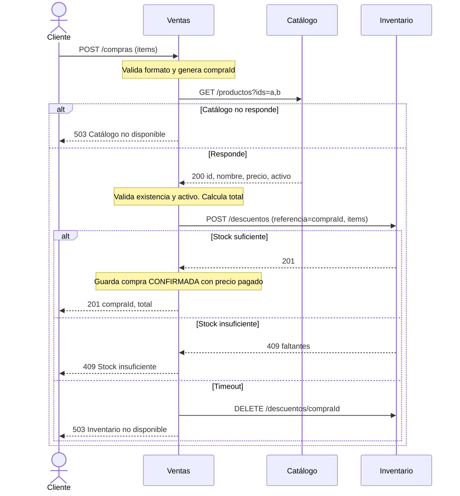
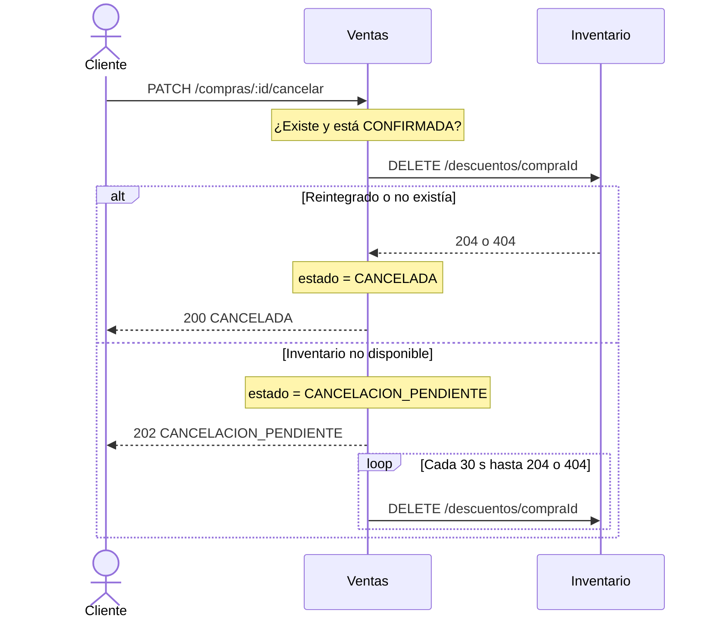

# 6. Comunicación entre microservicios

> Corresponde a la sección 10 del TP (entregables 13 y 14). Servicios según
> [`04-microservicios.md`](./04-microservicios.md); propiedad de datos según
> [`05-propiedad-datos.md`](./05-propiedad-datos.md).

En esta etapa toda la comunicación es **HTTP/REST síncrona**. Valores por defecto que
asume cada llamada entre servicios:

- **Timeout:** 3 s. Si se vence, el que llama lo trata como "destino no disponible".
- **Sin reintentos automáticos** dentro del pedido del cliente, salvo donde se indica
  (reintegro de stock pendiente).
- Errores que se traducen hacia el cliente: `503` si el destino no responde o no tiene
  Leader Raft, y el error de negocio del destino (`404`, `409`) traducido a un mensaje propio.

## 6.1 Comunicaciones descartadas

Antes de armar la matriz se revisó cada dependencia para ver si se podía **eliminar**:

| Comunicación candidata | Decisión | Motivo |
|---|---|---|
| Catálogo → Inventario, para mostrar el producto con su stock | **Eliminada** | El cliente compone las dos respuestas (`GET /productos/:id` y `GET /stock?productoIds=:id`). Catálogo no depende de Inventario (ver caso de uso 6.5.4). |
| Catálogo → Inventario, para borrar el stock cuando se borra un producto | **Eliminada** | La baja del producto es lógica. El registro de stock puede quedar: Ventas no vende productos inactivos. |
| Catálogo → Ventas, para avisar un cambio de precio | **Eliminada** | Ventas copia el precio al momento de la compra. Las compras viejas no se recalculan. |
| Inventario → Ventas, para confirmar el descuento | **Eliminada** | La respuesta de `POST /descuentos` ya informa el resultado. |
| Ventas → Inventario, para consultar stock antes de descontar | **Eliminada** | Sería consultar y después decidir: duplicaría la regla "no vender sin stock" en Ventas y abriría una carrera entre la consulta y el descuento. Ventas pide el descuento y Inventario decide. |

Resultado: **4 comunicaciones**, todas en un solo sentido. No hay ningún par de servicios
que se llame mutuamente.

## 6.2 Matriz de comunicaciones

| # | Origen | Destino | Necesidad | Método / endpoint | Datos intercambiados | Respuesta esperada |
|---|---|---|---|---|---|---|
| C1 | Ventas | Catálogo | Verificar que los productos existan y estén activos, y obtener el precio vigente y el nombre | `GET /productos?ids=a,b,c` | Envía: lista de ids · Recibe: `[{ id, nombre, precio, activo }]` | `200` con los productos encontrados (los ids ausentes no aparecen) |
| C2 | Ventas | Inventario | Descontar las unidades de la compra, todo o nada | `POST /descuentos` | Envía: `{ referencia: compraId, items: [{ productoId, cantidad }] }` · Recibe: `{ referencia, items }` | `201` descontado · `200` si esa referencia ya se había descontado (idempotente) · `409 { faltantes: [{ productoId, solicitado, disponible }] }` |
| C3 | Ventas | Inventario | Reintegrar las unidades si la compra se cancela o si falla después de descontar (compensación) | `DELETE /descuentos/:referencia` | Envía: `compraId` | `204` reintegrado · `404` no había descuento con esa referencia |
| C4 | Inventario | Catálogo | Verificar que el producto exista y esté activo antes de darle de alta su stock | `GET /productos/:id` | Envía: `productoId` · Recibe: `{ id, activo }` (ignora el resto) | `200` · `404` si no existe |

## 6.3 Análisis de cada comunicación

### C1 · Ventas → Catálogo (`GET /productos?ids=…`)

- **¿Es realmente necesario que un servicio conozca al otro?**
  Sí. Ventas necesita el precio para calcular el total y guardar el precio pagado, y el
  precio es de Catálogo. Además la regla "no se vende un producto inactivo" depende del
  estado `activo`, que también es de Catálogo.
- **¿Se está duplicando una regla de negocio?**
  No. Catálogo decide qué precio tiene cada producto y si está activo. Ventas solo usa ese
  resultado para decidir si acepta la compra.
- **¿La información podría pertenecer al servicio que la necesita?**
  No el precio *vigente*: lo cambia la administración del catálogo, no las ventas. Lo que
  sí pertenece a Ventas es la **copia** del precio pagado, y por eso se guarda localmente
  (ver 5.2).
- **¿El contrato puede expresarse sin detalles internos?**
  Sí: "dame id, nombre, precio y estado de estos productos". Ventas no sabe si Catálogo usa
  Mongo, cuántos nodos Raft tiene ni qué es `version`.
- **¿Qué pasa si el destino no está disponible?**
  Ventas espera 3 s y responde `503 Catálogo no disponible`. No se descontó stock y no se
  guardó nada: no queda nada a medias.

### C2 · Ventas → Inventario (`POST /descuentos`)

- **¿Es realmente necesario que un servicio conozca al otro?**
  Sí. Registrar una compra sin descontar stock viola "no vender sin stock", y esa regla es
  de Inventario.
- **¿Se está duplicando una regla de negocio?**
  No. Ventas no lee ni calcula el stock: interpreta `201` o `409`. Ventas valida que
  `cantidad` sea un entero mayor que 0 porque es el formato de *su* pedido. Inventario
  vuelve a validar el formato de su propio contrato, pero eso es validación de entrada, no
  una regla de negocio duplicada.
- **¿La información podría pertenecer al servicio que la necesita?**
  No. Si Ventas guardara stock, volveríamos al acoplamiento actual: dos funcionalidades
  escribiendo el mismo número.
- **¿El contrato puede expresarse sin detalles internos?**
  Sí: "descontá estas cantidades de estos productos, para esta referencia". Ventas no sabe
  que Inventario toma un lock en Redis ni que replica con Raft (hoy esos detalles están
  mezclados en `comprarProducto`).
- **¿Qué pasa si el destino no está disponible?**
  Si no responde (conexión rechazada o `503` sin Leader), Ventas responde `503` y no guarda
  la compra. Si se vence el timeout, el descuento **pudo** haberse aplicado. Por eso la
  `referencia` es el `compraId`: Ventas envía `DELETE /descuentos/:compraId` (C3) para
  dejar todo como estaba, y responde `503`. Si ese reintegro también falla, se encola como
  en la cancelación (ver 6.4).

### C3 · Ventas → Inventario (`DELETE /descuentos/:referencia`)

- **¿Es realmente necesario que un servicio conozca al otro?**
  Sí. Es la única forma de devolver unidades sin que Ventas toque el stock.
- **¿Se está duplicando una regla de negocio?**
  No. La regla "se puede cancelar solo si está CONFIRMADA" es de Ventas. Inventario no
  decide si corresponde cancelar: reintegra cuando se lo piden.
- **¿La información podría pertenecer al servicio que la necesita?**
  No, por el mismo motivo que C2.
- **¿El contrato puede expresarse sin detalles internos?**
  Sí. Ventas solo conoce su propio `compraId`; no necesita ids internos de Inventario.
- **¿Qué pasa si el destino no está disponible?**
  En una cancelación, la compra pasa a `CANCELACION_PENDIENTE`, se responde `202` y un
  proceso de Ventas reintenta el `DELETE` cada 30 s hasta obtener `204` o `404`. Es seguro
  reintentar porque el reintegro es idempotente por referencia. Mientras tanto, las
  unidades siguen descontadas, que es el error menos grave: no permite vender de más.

### C4 · Inventario → Catálogo (`GET /productos/:id`)

- **¿Es realmente necesario que un servicio conozca al otro?**
  Es la dependencia más discutible (ver [`07-validacion-limites.md`](./07-validacion-limites.md)).
  Se mantiene porque sin ella Inventario podría tener stock de ids inexistentes o mal
  escritos. Solo se usa al **dar de alta** el stock de un producto, no en cada ajuste ni en
  cada compra.
- **¿Se está duplicando una regla de negocio?**
  No. Inventario no valida nombre, precio ni categoría: solo pregunta si el id existe y
  está activo.
- **¿La información podría pertenecer al servicio que la necesita?**
  No. La existencia del producto es de Catálogo.
- **¿El contrato puede expresarse sin detalles internos?**
  Sí. Usa el mismo endpoint público que el cliente.
- **¿Qué pasa si el destino no está disponible?**
  Inventario responde `503` al alta de stock. El producto queda en Catálogo sin stock
  (equivale a 0 disponible: no se puede vender) y la operación se puede reintentar, porque
  `PUT` es idempotente. Las compras, consultas y ajustes de productos que ya tienen stock no
  se ven afectados.

## 6.4 Comportamiento ante fallos

| Comunicación | Si el destino no responde | Si responde error de negocio | ¿Queda algo a medias? |
|---|---|---|---|
| C1 Ventas → Catálogo | `503` al cliente, no se crea nada | Algún id no vuelve en la respuesta → `400 { productosInexistentes }` · alguno inactivo → `409 { productosInactivos }` | No |
| C2 Ventas → Inventario (descontar) | Sin conexión o `503`: `503`, no se guarda la compra · timeout: compensación con C3 y `503` | `409` stock insuficiente → `409 { faltantes }` al cliente | Solo si falla también la compensación: se encola el reintegro (como en C3) |
| C3 Ventas → Inventario (reintegrar) | Compra en `CANCELACION_PENDIENTE` y reintento periódico | `404` → no había descuento, se considera reintegrado | Sí, temporalmente: unidades descontadas de más hasta que el reintento funcione |
| C4 Inventario → Catálogo | `503` al alta de stock | `404` → `404 Producto inexistente` · inactivo → `409` | No: el producto existe sin stock y se reintenta el alta |

## 6.5 Trazado de casos de uso

### 6.5.1 Registrar una compra

Reemplaza a `POST /api/productos/:id/comprar`. Inicia el **cliente**.

```
Cliente
 │  POST /compras { items: [{ productoId, cantidad }] }
 ▼
Ventas ── valida el formato (cantidad entera > 0); genera compraId
 │  HTTP GET /productos?ids=…                                     (C1)
 ▼
Catálogo ── informa id, nombre, precio y activo. No modifica nada.
 │  200 [...]
 ▼
Ventas ── decide: ¿existen todos? ¿están activos? Calcula el total con precios vigentes
 │  HTTP POST /descuentos { referencia: compraId, items }         (C2)
 ▼
Inventario ── decide: ¿alcanza el stock para todos? → MODIFICA stock y registra movimientos
 │  201  |  409 { faltantes }
 ▼
Ventas ── MODIFICA compras: guarda la compra CONFIRMADA con ítems, precio pagado y total
 │
 ▼
Respuesta: 201 { compraId, estado: "CONFIRMADA", total, items }
```

| Paso | Servicio | Decisión que toma | Datos que consulta | Estado que modifica |
|---|---|---|---|---|
| 1 | Ventas | ¿El pedido tiene un formato válido? | — | — |
| 2 | Catálogo | Ninguna (solo informa) | Productos y precios | — |
| 3 | Ventas | ¿Los productos existen y están activos? ¿Cuál es el total? | Respuesta de Catálogo | — |
| 4 | Inventario | ¿Hay stock para todo? (todo o nada, bajo lock por producto) | Stock | Stock y movimientos |
| 5 | Ventas | Confirma la compra | — | Compra e ítems |

**Caminos de error:**

- Catálogo caído → `503`, nada modificado.
- Producto inexistente → `400`; producto inactivo → `409`. No se llama a Inventario.
- Stock insuficiente → `409` con los faltantes, nada modificado.
- Otra compra tiene tomado el lock del producto → Inventario espera hasta liberarlo (hoy se
  responde `409` inmediato; con el lock dentro de Inventario se puede esperar un tiempo
  corto sin que Ventas lo sepa).
- Inventario no responde a tiempo → compensación `DELETE /descuentos/:compraId` y `503`.
- Falla al guardar la compra **después** de descontar → compensación
  `DELETE /descuentos/:compraId` para no dejar stock descontado sin compra.



### 6.5.2 Cancelar una compra

Inicia el **cliente**. Es una operación nueva: hoy no se puede deshacer una compra.

```
Cliente
 │  PATCH /compras/:id/cancelar
 ▼
Ventas ── decide: ¿se puede cancelar? (solo si está CONFIRMADA)
 │  HTTP DELETE /descuentos/:compraId                              (C3)
 ▼
Inventario ── MODIFICA stock: reintegra las unidades y registra el movimiento
 │  204
 ▼
Ventas ── MODIFICA compras: estado = "CANCELADA"
 │
 ▼
Respuesta: 200 { compraId, estado: "CANCELADA" }
```

| Paso | Servicio | Decisión que toma | Datos que consulta | Estado que modifica |
|---|---|---|---|---|
| 1 | Ventas | ¿La compra existe y está CONFIRMADA? | Compra | — |
| 2 | Inventario | Ninguna: reintegra lo que se descontó con esa referencia | Descuento por referencia | Stock y movimientos |
| 3 | Ventas | Cierra la compra | — | Estado de la compra |

**¿Quién decide si una compra se puede cancelar?** Ventas, porque es una regla del ciclo de
vida de la compra. Inventario no decide nada: reintegra cuando se lo piden. Cada regla
tiene un solo dueño.

**Caminos de error:**

- Compra inexistente → `404`. Ya cancelada → `409`.
- Inventario no disponible → la compra queda `CANCELACION_PENDIENTE`, se responde
  `202 { estado: "CANCELACION_PENDIENTE" }` y Ventas reintenta el `DELETE` hasta lograrlo.
- Inventario responde `404` → no había nada para reintegrar, se marca `CANCELADA`.



### 6.5.3 Dar de alta un producto con stock inicial

Hoy es un solo `POST /api/productos` con `stock`. En la propuesta cruza dos servicios,
porque el producto y su stock tienen dueños distintos. Lo inicia el **cliente
administrador**, que hace dos pedidos.

```
Cliente
 │  POST /productos { nombre, precio, categoria }
 ▼
Catálogo ── decide: ¿nombre único? ¿precio > 0? ¿categoría válida? → MODIFICA productos
 │  201 { id }
 ▼
Cliente
 │  PUT /stock/:id { cantidad: 10 }
 ▼
Inventario ── es el primer stock de este id → hay que verificar que el producto exista
 │  HTTP GET /productos/:id                                        (C4)
 ▼
Catálogo ── informa que existe y está activo. No modifica nada.
 │  200
 ▼
Inventario ── decide: ¿cantidad entera ≥ 0? → MODIFICA stock y registra movimiento ALTA
 │
 ▼
Respuesta: 200 { productoId, stock: 10 }
```

| Paso | Servicio | Decisión que toma | Datos que consulta | Estado que modifica |
|---|---|---|---|---|
| 1 | Catálogo | Valida nombre único, precio y categoría | Productos | Crea el producto |
| 2 | Catálogo | Ninguna (solo informa) | Producto | — |
| 3 | Inventario | Valida la cantidad | Stock | Crea stock y movimiento |

**Caminos de error:** si Catálogo no responde en el paso 2, Inventario devuelve `503` y el
producto queda sin stock: no se puede vender hasta que el alta de stock se reintente. Es
un estado válido, no inconsistente. Se acepta que esta operación pase de un pedido a dos a
cambio de que el stock tenga un solo dueño.

### 6.5.4 Consultar un producto con su disponibilidad (degradación)

Muestra que esta consulta **no** genera dependencia entre Catálogo e Inventario.

```
Cliente ──► Catálogo    GET /productos/:id              → 200 { id, nombre, precio, ... }
Cliente ──► Inventario  GET /stock?productoIds=:id      → 200 [{ productoId, stock }]
```

Las dos llamadas son independientes y el cliente puede hacerlas en paralelo. Si Inventario
está caído, el producto se muestra igual con "disponibilidad no informada": es
**degradación**, no error. Si Catálogo está caído, no hay producto para mostrar.
