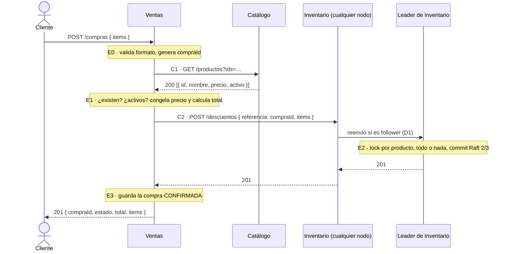
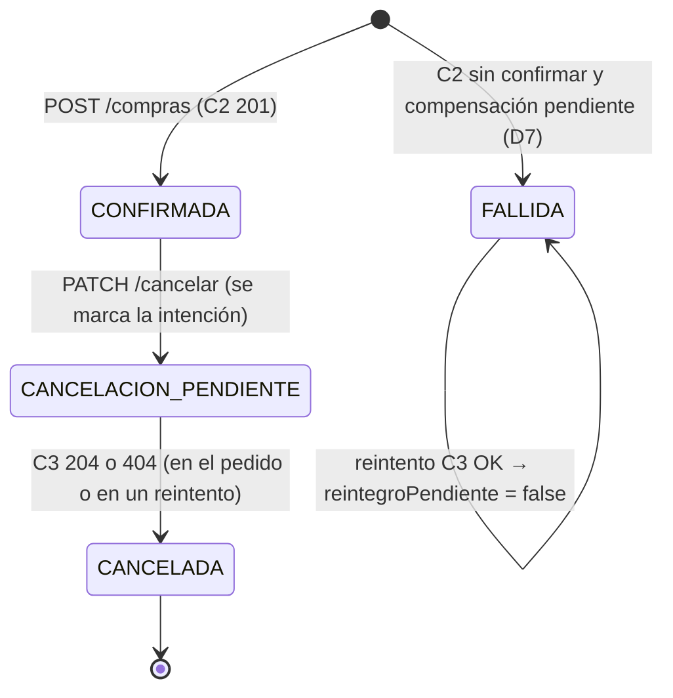

# 12. Comunicación entre servicios y manejo de fallos

> Corresponde a las secciones 7, 8.1 y 15 del TP6 (entregable 14, y la parte de comunicación
> y fallos del entregable 11). Parte 3 · Matías Porcari.
>
> Implementa lo especificado en el TP5 ([`06-comunicaciones.md`](./06-comunicaciones.md) §6.2
> a §6.5 y la ficha de Ventas de [`04-microservicios.md`](./04-microservicios.md#servicio-ventas))
> con las decisiones del Hito 1 ([`08-ratificacion-tp6.md`](./08-ratificacion-tp6.md)). Lo que
> se descubrió al implementarlo está en §12.7.

## 12.1 Recorrido final de los casos de uso

| Caso de uso | Entrada | Servicio responsable | Servicios consultados | Resultado |
|---|---|---|---|---|
| Registrar compra | `POST /compras { items }` | Ventas | Catálogo (C1), Inventario (C2; C3 si hay que compensar) | `201` · `400` · `409` · `502` · `503` |
| Cancelar compra | `PATCH /compras/:id/cancelar` | Ventas | Inventario (C3) | `200` · `202` · `404` · `409` |
| Consultar compra | `GET /compras/:id` | Ventas | Ninguno (lee solo su base) | `200` · `400` · `404` |
| Alta de producto con stock | `POST /productos` + `PUT /stock/:id` | Catálogo, luego Inventario | Catálogo (C4) | `201` + `200` · `404` · `409` · `503` |
| Producto con disponibilidad | `GET /productos/:id` + `GET /stock?productoIds=` | Catálogo e Inventario, por separado | Ninguno (lo compone el cliente) | Degradación si Inventario no responde |

`POST /compras` reemplaza a `POST /api/productos/:id/comprar` del TP4, que en una sola
función validaba, tomaba el lock de Redis, decidía el stock y armaba el comando de Raft
(Caso 3 de [`03-acoplamientos.md`](./03-acoplamientos.md)). Ahora cada decisión está en su
dueño: Catálogo informa, Inventario decide sobre el stock y Ventas solo coordina y registra.

Evidencia de una compra real recorriendo los tres servicios:
[`evidencias/comunicacion.md`](./evidencias/comunicacion.md).

## 12.2 Comunicaciones implementadas

| # | Origen → destino | Endpoint | Módulo cliente | URL (variable) | Timeout |
|---|---|---|---|---|---|
| C1 | Ventas → Catálogo | `GET /productos?ids=a,b,c` | `services/ventas/src/clients/catalogoClient.js` | `CATALOGO_SERVICE_URL` | `HTTP_TIMEOUT_MS` = 3000 |
| C2 | Ventas → Inventario | `POST /descuentos` | `services/ventas/src/clients/inventarioClient.js` | `INVENTARIO_SERVICE_URL` | 3000 |
| C3 | Ventas → Inventario | `DELETE /descuentos/:referencia` | `services/ventas/src/clients/inventarioClient.js` | `INVENTARIO_SERVICE_URL` | 3000 |
| C4 | Inventario → Catálogo | `GET /productos/:id` | `services/inventario/src/clients/catalogoClient.js` (Parte 2) | `CATALOGO_SERVICE_URL` | 3000 |

- **Un solo lugar con `fetch`** por servicio. En Ventas, `httpClient.js` concentra la URL
  base, el timeout explícito (`AbortSignal.timeout`) y la interpretación de la respuesta.
  Controllers y servicios reciben un resultado o un error tipado, nunca detalles de `fetch`.
- **Sin direcciones fijas:** en local las URLs son `http://localhost:3100` y
  `http://localhost:3201`; en Compose, `http://catalogo-service:3100` y
  `http://inventario-service:3200`. Cambia solo la configuración, nunca el código.
- **Ventas no sabe que Inventario es un cluster.** `inventario-service` es un alias DNS que
  comparten los 3 nodos, y los followers reenvían las escrituras al Leader (D1). Ventas no
  conoce puertos de nodos, no interpreta `421` ni lee headers `X-Raft-*`.
- **Sin reintentos dentro del pedido del cliente** (TP5 §6): solo se reintenta el reintegro
  (C3), en segundo plano.

## 12.3 Semántica de errores entre servicios

El cliente HTTP clasifica cada resultado en tres tipos (`services/ventas/src/errors/`):

| Tipo | Cuándo | Qué conserva |
|---|---|---|
| `DependenciaNoDisponible` | No hubo respuesta: `timeout`, `dns` (el nombre no resuelve) o `conexion` (rechazada) | dependencia, causa, operación |
| `RespuestaRemota` | Hubo respuesta, pero no exitosa (4xx, 5xx) | dependencia, status, cuerpo remoto |
| `ErrorNegocio` | Lo que Ventas le responde a **su** cliente | status, mensaje y detalle |

La capa de negocio (`comprasService.js`) traduce cada situación así:

| Llamada | Situación remota | Qué hace Ventas | Responde al cliente |
|---|---|---|---|
| C1 | Sin respuesta (timeout, DNS, conexión) o `503` | Nada que deshacer | `503` Catálogo no disponible |
| C1 | `200` sin alguno de los ids | — | `400 { productosInexistentes }` (no es un `503`) |
| C1 | `200` con algún `activo: false` | — | `409 { productosInactivos }` |
| C1 | Otro código o formato inesperado | Log con contexto | `502` |
| C2 | Conexión rechazada o DNS | El descuento **no** se aplicó | `503` Inventario no disponible |
| C2 | Timeout, `5xx` o `421` | El descuento **pudo** aplicarse → compensación C3 (§12.4) | `503` con `compraId` y `compensacion` |
| C2 | `409 { faltantes }` | Nada que deshacer | `409 { faltantes }` |
| C2 | `409` sin `faltantes` (el lock del producto siguió ocupado) | Nada que deshacer | `409` con el mensaje de Inventario |
| C2 | `400` u otro 4xx | No se aplicó: desacuerdo de contrato | `502` |
| C2 | `201` o `200` (referencia ya descontada) | Guarda la compra | `201` |
| C3 (cancelación) | `204` o `404` | Se considera reintegrado | `200 CANCELADA` |
| C3 (cancelación) | Sin respuesta o error | Queda `CANCELACION_PENDIENTE`, se reintenta | `202` |
| C3 (compensación) | `204` | Reintegrado | (`503` del caso C2) |
| C3 (compensación) | `404`, sin respuesta o error | Compra `FALLIDA` con `reintegroPendiente` (D7), se reintenta | (`503` del caso C2) |
| — | La base de Ventas no responde | Rechaza **antes** de llamar a nadie | `503` Base de datos no disponible |

Dos ideas que guían la tabla:

- **Un `409` o un id ausente no son una caída.** Son respuestas funcionales de una
  dependencia sana, y se traducen a un `400`/`409` propio.
- **Una caída de Catálogo o Inventario no es un `500` de Ventas.** Es un `503` con el campo
  `dependencia`, y el log registra la causa real (`dns`, `timeout` o `conexion`). En las
  pruebas, ninguna caída produjo un `500` ni derribó a Ventas
  ([`evidencias/fallo-dependencia.md`](./evidencias/fallo-dependencia.md)).

**Por qué se compensa también ante un `503` de Inventario:** con Raft, un `503` puede
significar "no logró mayoría a tiempo" (`RAFT_COMMIT_TIMEOUT_MS`), y esa entrada todavía
puede confirmarse después. Compensar es seguro porque el reintegro es idempotente por
referencia.

## 12.4 Análisis de fallo parcial: registrar una compra

Se eligió **registrar una compra** porque es el único caso de uso que modifica estado en
**dos** servicios (Inventario y Ventas) con una sola operación del cliente.

### 1. Servicios que participan y orden

| Etapa | Servicio | Operación | Estado que cambia |
|---|---|---|---|
| E0 | Ventas | Valida el formato y genera `compraId` | Ninguno |
| E1 | Ventas → Catálogo | C1 `GET /productos?ids=` | Ninguno (Catálogo solo informa) |
| E2 | Ventas → Inventario | C2 `POST /descuentos` | Stock, descuento por referencia y movimiento `DESCUENTO`, replicados en los 3 nodos |
| E3 | Ventas | Guarda la compra | Compra `CONFIRMADA` con ítems, precio pagado y total |

La primera etapa que **confirma** un cambio es E2. Todo lo que falle antes no deja nada a
medias; todo lo que falle después puede dejar stock descontado sin compra.

### 2. Qué pasa si falla cada etapa

| Falla en | Situación | Estado que queda | ¿Consistente? | Qué hace el sistema |
|---|---|---|---|---|
| E0 | Pedido mal formado | Nada cambió | Sí | `400` |
| E0 | `ventas-db` caída antes de empezar | Nada cambió | Sí | `503` sin llamar a nadie |
| E1 | Catálogo caído o lento | Nada cambió | Sí | `503` |
| E1 | Producto inexistente o inactivo | Nada cambió | Sí | `400` / `409` |
| E2 | Conexión rechazada o DNS | Nada cambió (el pedido no llegó) | Sí | `503` |
| E2 | `409` sin stock o lock ocupado | Nada cambió | Sí | `409` |
| E2 | Timeout o `5xx`: el descuento **pudo** aplicarse | Stock descontado sin compra, **hasta que llega el reintegro** | Temporalmente no | Compensa con C3. Si C3 no confirma (o responde `404`, ver abajo), compra `FALLIDA` + `reintegroPendiente` y reintento cada 30 s (D7) |
| E3 | `ventas-db` se cae entre E2 y E3 | Stock descontado sin compra | No | Compensa con C3. Si C3 también falla, intenta guardar la `FALLIDA`; como la base está caída, **solo queda el log** con el `compraId` |
| E2–E3 | El proceso de Ventas muere entre E2 y E3 | Stock descontado sin compra | No | **Nada lo detecta automáticamente** |
| Cancelación | C3 funcionó pero falla guardar `CANCELADA` | Stock reintegrado, compra en `CANCELACION_PENDIENTE` | Temporalmente no | El reintento la termina de cerrar (C3 es idempotente: `204`) |

### 3. El caso más fino: un reintegro que llega antes que el descuento

Si C2 vence por timeout, el descuento puede seguir en camino: esperando el lock del
producto, en tránsito desde un follower o esperando el commit de Raft. Ventas manda C3
enseguida, Inventario todavía no tiene descuento con esa referencia y responde `404`... y
**después** el descuento se aplica. Si Ventas tomara ese `404` como "no había nada", las
unidades quedarían descontadas sin compra para siempre.

Una vez que las dos entradas están en el log del Leader, Raft garantiza el orden. El hueco es
el descuento que todavía **no fue propuesto** cuando llega C3. D3
(`RAFT_COMMIT_TIMEOUT_MS=2500` < 3000) achica esa ventana, pero no la elimina: la demora puede
estar en el lock o en el reenvío, antes de proponer.

**Cómo se cerró en la implementación:** después de un timeout, un `404` de la compensación
**no se considera definitivo**. La compra se guarda `FALLIDA` con `reintegroPendiente: true`, y
el reintento de los 30 s vuelve a pedir C3. Para entonces, el descuento atrasado ya terminó
(se aplicó o se descartó): si se aplicó, C3 responde `204` y lo revierte; si no, `404`, que ya
es definitivo. Se reprodujo con `DESCUENTO_DELAY_MS=5000`: el stock bajó a 8 dos segundos
después del `404` y el reintento lo devolvió a 10, con `DESCUENTO` y `REINTEGRO` de la misma
referencia ([`evidencias/fallo-parcial.md`](./evidencias/fallo-parcial.md), caso 1).

### 4. ¿Puede quedar un estado inconsistente?

Sí, en tres situaciones:

| Situación | Duración | Gravedad |
|---|---|---|
| Descuento sin confirmar, con la compra `FALLIDA` pendiente de reintegro | Hasta el siguiente reintento con Inventario disponible (≤ 30 s en las pruebas) | Baja: unidades bloqueadas de más, nunca se vende de más |
| `ventas-db` caída después del descuento y C3 también falla | Indefinida: queda solo en el log de Ventas | Media: requiere intervención manual con el `compraId` del log |
| Ventas se cae entre E2 y E3 | Indefinida, y **sin registro** | Media: no hay forma automática de detectarlo hoy |

En todos los casos el error es en el sentido seguro: sobran unidades descontadas, nunca
faltan (no se vende stock inexistente). Lo inverso, una compra `CONFIRMADA` sin descuento, no
puede ocurrir: Ventas solo confirma después de un `201`/`200` de Inventario.

### 5. Qué haría falta para detectar, recuperar o compensar (evolución futura)

- **Ya disponible:**
  - `referencia` = `compraId` en los descuentos y movimientos de Inventario;
  - los estados `FALLIDA` y `CANCELACION_PENDIENTE` y `reintegroPendiente` en Ventas;
  - el `compraId` en cada log y en la respuesta `503` al cliente.
- **Detección:** un proceso de conciliación que compare los descuentos vigentes de Inventario
  con las compras `CONFIRMADA` de Ventas y reintegre los que no tengan compra. Hoy Inventario
  no expone un listado de descuentos (solo `GET /movimientos`): habría que agregarlo.
- **No perder la intención:** guardar la compra como `PENDIENTE` **antes** de C2 (patrón
  outbox). Cubre el caso "Ventas se cae entre E2 y E3", pero cambia la regla de la ficha "con
  stock insuficiente no se guarda nada", así que queda para un TP posterior.
- **Rechazar descuentos tardíos:** que Inventario recuerde las referencias reintegradas o
  anuladas, para rechazar un descuento que llegue después con esa misma referencia. Cerraría
  la carrera de §12.4.3 del lado de Inventario, sin depender del reintento.
- **Trazabilidad:** propagar un header `X-Correlation-Id` de Ventas a Catálogo e Inventario y
  loguearlo en los tres servicios.
- **A futuro:** saga con estados explícitos o mensajería asíncrona (cola de reintegros
  persistente fuera de Ventas).

## 12.5 Cancelación y reintentos

- La cancelación marca primero la intención de forma **atómica** (`CONFIRMADA` →
  `CANCELACION_PENDIENTE`). Así dos cancelaciones simultáneas no pasan las dos, y si Ventas se
  cae después del reintegro, el reintento termina de cerrarla.
- El proceso de reintentos (`services/ventas/src/services/reintentos.js`) corre cada
  `REINTENTO_REINTEGRO_MS` (30 s por defecto). Busca las compras en `CANCELACION_PENDIENTE` y
  las que tienen `reintegroPendiente: true`, y vuelve a pedir C3. No se superponen dos
  ejecuciones, y es seguro repetir: el reintegro es idempotente por referencia.
- Mientras un reintegro está pendiente, las unidades siguen descontadas. Es el error menos
  grave: no permite vender de más.

## 12.6 Referencias lógicas entre servicios (sección 8.1)

| Ventas guarda | Referencia a | Cómo se valida | Lo que Ventas **no** hace |
|---|---|---|---|
| `items[].productoId` | Producto de Catálogo | C1 al crear la compra: tiene que existir y estar activo | Leer la base de Catálogo; volver a consultarlo al leer una compra |
| `items[].nombreProducto`, `items[].precioUnitario` | Copias del producto al momento de la compra | Se copian de la respuesta de C1 | Actualizarlas si Catálogo cambia el precio o el nombre |
| `_id` de la compra = `referencia` del descuento | Descuento de Inventario | La genera Ventas antes de C2; Inventario la usa como clave idempotente | Guardar ids internos de Inventario |

La base `ventas` tiene una sola colección, `compras`: Ventas no escribe en ninguna otra
base ni colección.

## 12.7 Diferencias respecto de `06-comunicaciones.md` (TP5)

Para registrar en [`arquitectura.md`](./arquitectura.md) y en el acta del Hito 1:

| # | TP5 decía | Implementado | Motivo |
|---|---|---|---|
| 1 | Si C2 vence y la compensación falla, "se encola", pero la compra no se guarda | Compra `FALLIDA` con `reintegroPendiente: true` | Decisión D7 |
| 2 | En una compensación, `404` de C3 = no había descuento | Después de un timeout, el `404` no es definitivo: se registra como pendiente y se verifica en el siguiente reintento | El descuento puede aplicarse después del `404` (§12.4.3). Se reprodujo en las pruebas |
| 3 | C2 `409` = stock insuficiente `{ faltantes }` | También puede ser un `409` sin `faltantes`, cuando el lock del producto sigue ocupado después de `LOCK_WAIT_MS` | Inventario espera el lock un tiempo corto antes de rechazar (TP5 §6.5.1, "caminos de error"). Ventas lo traduce a un `409` con el mensaje de Inventario |
| 4 | Una respuesta inesperada de una dependencia no estaba definida | `502` (C1 con código o formato inesperado; C2 con `400` u otro 4xx) | Sección 15.2 del TP6: registrar contexto y responder de forma controlada |
| 5 | La cancelación llama a C3 y después cambia el estado | Marca primero `CANCELACION_PENDIENTE` (atómico) y después llama a C3 | Evita dos cancelaciones simultáneas y que una caída de Ventas deje una compra `CONFIRMADA` con el stock ya reintegrado |
| 6 | El `503` de una compra no traía detalle | Si hubo que compensar, el `503` informa `compraId` y `compensacion` (`reintegrado` / `pendiente`) | Que el cliente pueda consultar la compra `FALLIDA` y que el fallo sea observable |
| 7 | Con la base de Ventas caída no estaba definido | `503` antes de llamar a Catálogo o Inventario | No descontar stock de una compra que después no se podría guardar |

Ninguna cambia los contratos C1–C3: son decisiones internas de Ventas sobre cómo interpretar
las respuestas.

**Pedidos a otras partes (para el `compose.yml` de la Parte 1):**

- En `ventas-service`: `REINTENTO_REINTEGRO_MS: ${REINTENTO_REINTEGRO_MS:-30000}`, para poder
  bajarlo en las pruebas sin editar archivos.
- En `x-inventario-env`: `DESCUENTO_DELAY_MS: ${DESCUENTO_DELAY_MS:-0}`, para reproducir el
  timeout de §12.4 con `DESCUENTO_DELAY_MS=5000 docker compose up -d inventario-1 inventario-2 inventario-3`.

## 12.8 Sesión de fallos (fase 4)

**Duración:** 45 min. **Participan los tres:**
- **Parte 2:** maneja el cluster de Inventario.
- **Parte 1:** registra la evidencia.
- **Parte 3:** explica qué estado quedó en cada servicio.

**Antes de empezar:** `docker compose down -v && docker compose up --build -d`, esperar a que
todo esté `healthy` y `node scripts/seed.js`.

| Min | Escenario | Comando | Qué hay que poder explicar |
|---|---|---|---|
| 0–5 | Base | `node scripts/smoke-test.js` | 23 OK: el punto de partida está sano |
| 5–13 | A · Catálogo caído | `docker compose stop catalogo-service` + compra | `503`, causa `dns`, Ventas sigue `healthy`, nada descontado. Con `pause`, causa `timeout` |
| 13–23 | B · Inventario caído con cancelación | `docker compose stop inventario-1 inventario-2 inventario-3` + `PATCH /cancelar` | `202 CANCELACION_PENDIENTE`; al volver Inventario, `CANCELADA` y stock reintegrado en ≤ 30 s |
| 23–31 | C · Solo el Leader caído (Parte 2) | `docker compose stop <leader>` + compra | Tras la elección, las compras siguen dando `201`: el cluster oculta el fallo a Ventas |
| 31–41 | Timeout y D7 (§12.4) | `DESCUENTO_DELAY_MS=5000 docker compose up -d inventario-1 inventario-2 inventario-3` + compra | `503`, compra `FALLIDA` pendiente, el descuento atrasado y su reintegro en `GET /movimientos` |
| 41–45 | Cierre | `docker compose up -d inventario-1 inventario-2 inventario-3` + smoke test | Todo vuelve a 23 OK. Si apareció un comportamiento no documentado, se abre un `fix/…` y se linkea en la evidencia |

Los comandos completos de cada escenario están en
[`evidencias/fallo-dependencia.md`](./evidencias/fallo-dependencia.md) y
[`evidencias/fallo-parcial.md`](./evidencias/fallo-parcial.md).

## 12.8 bis · TP7: identidad en la comunicación

Desde el TP7, Ventas llama a Inventario (C2 y C3) con el token de su cuenta técnica (rol `SERVICIO`) y le
pasa el `usuarioId` del cliente; el reintento de 30 s usa la misma cuenta, así que la compensación no
depende de que el cliente siga conectado. Obtener ese token es un punto de falla nuevo **antes** del
descuento: si `auth-service` no responde y el token en caché venció, la compra da `503` sin estado
parcial. Detalle en [`17-propagacion-identidad.md`](./17-propagacion-identidad.md).

## 12.9 Evidencias de la Parte 3

| Prueba (sección 18) | Evidencia | Comando para repetirla |
|---|---|---|
| Docker instalado | [`docker-porcari.md`](./evidencias/docker-porcari.md) | `docker run --rm hello-world` |
| CRUD / negocio | [`crud-negocio.md`](./evidencias/crud-negocio.md) | `node scripts/smoke-test.js` |
| Comunicación | [`comunicacion.md`](./evidencias/comunicacion.md) | compra con `docker compose logs -f` abierto |
| Fallo de dependencia | [`fallo-dependencia.md`](./evidencias/fallo-dependencia.md) | `docker compose stop catalogo-service` |
| Fallo parcial | [`fallo-parcial.md`](./evidencias/fallo-parcial.md) | `DESCUENTO_DELAY_MS=5000 docker compose up -d inventario-1 inventario-2 inventario-3` |
| Datos de prueba | [`datos-prueba.md`](./evidencias/datos-prueba.md) | `docker compose down -v && docker compose up --build -d && node scripts/seed.js` |
