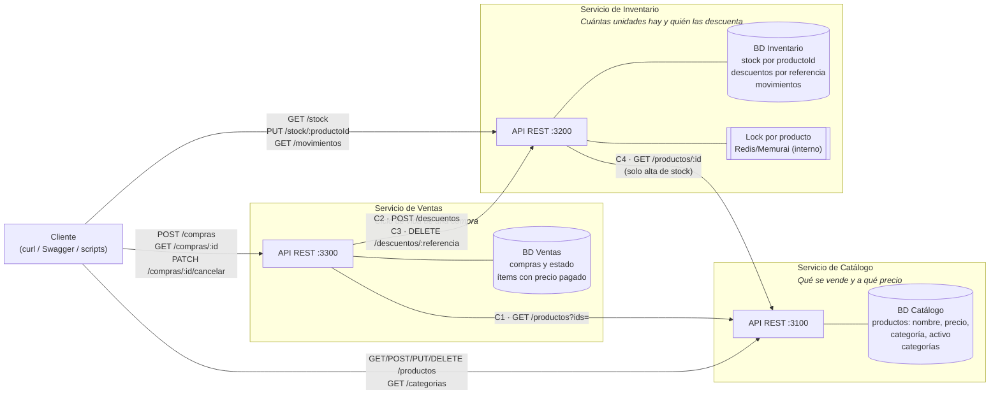
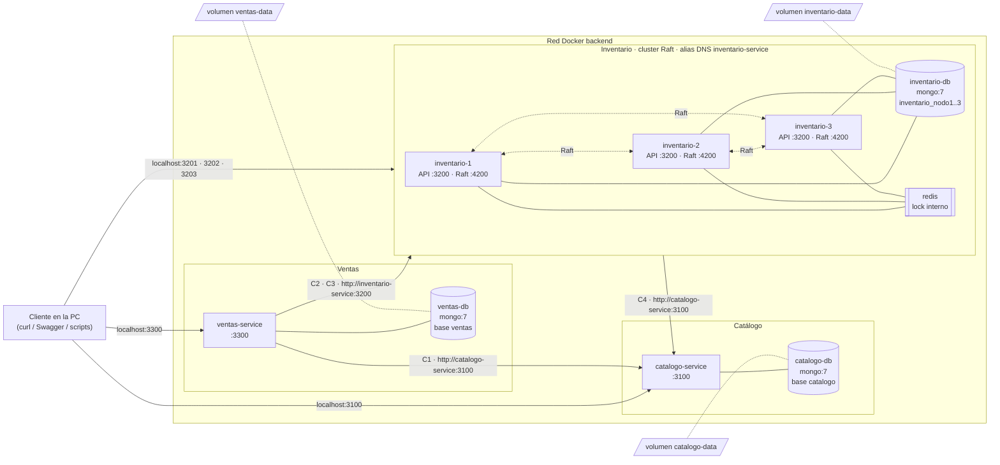
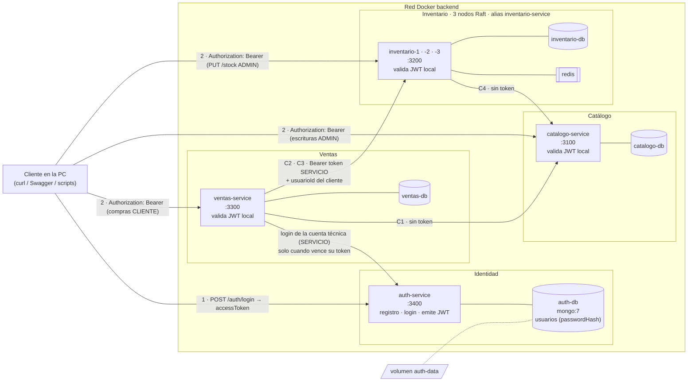

# Diagrama de arquitectura propuesta

> Corresponde a la sección 11 del TP (entregable 15). Representa las decisiones de
> [`04-microservicios.md`](./04-microservicios.md), [`05-propiedad-datos.md`](./05-propiedad-datos.md)
> y [`06-comunicaciones.md`](./06-comunicaciones.md).

## Despliegue en el TP6 (Docker Compose)

El diagrama de arriba es la arquitectura lógica del TP5 y sigue valiendo. Este muestra cómo
quedó desplegada en el TP6 con [`compose.yml`](../compose.yml): los contenedores, la red
`backend`, los puertos y los volúmenes. Detalle en [`09-ejecucion-docker.md`](./09-ejecucion-docker.md).

| Elemento | Significado |
|---|---|
| Recuadro dentro de la red | Un contenedor. El texto es su nombre DNS en Compose y su puerto **interno** |
| Flecha desde el Cliente | Puerto **publicado** en la PC. Las bases, Redis y el puerto Raft 4200 no se publican |
| Flecha entre servicios | Llamada HTTP con la URL que usa el servicio dentro de la red (C1–C4) |
| Línea punteada entre nodos | RPC interno de Raft, solo dentro de la red |
| Paralelogramo | Volumen con nombre: los datos sobreviven a `docker compose down` |

Lo que cambió respecto del diagrama lógico, y por qué, está en
[`arquitectura.md`](./arquitectura.md#tp6-cambios-respecto-del-tp5): los followers reenvían
las escrituras al Leader y los 3 nodos comparten el alias `inventario-service` (D1), y las 3
bases de Inventario están en un solo contenedor (D2).

## Despliegue en el TP7 (con auth-service)

El TP7 agrega `auth-service` y su base. Las flechas C1–C4 son las mismas; lo nuevo son los
tokens. Decisiones en [`14-modelo-seguridad.md`](./14-modelo-seguridad.md), identidad en
[`15-identidad.md`](./15-identidad.md).

| Elemento | Significado |
|---|---|
| "valida JWT local" | Cada servicio verifica firma, emisor y vencimiento con `JWT_SECRET`, **sin consultar** a `auth-service` (D15). Por eso las únicas flechas hacia `auth-service` son los logins |
| Ventas → auth-service | La única llamada entre servicios nueva: Ventas obtiene su token `SERVICIO` y lo reusa hasta 1 minuto antes de que venza (D13) |
| C2 · C3 con token `SERVICIO` | Inventario sabe que la operación la autorizó Ventas, y para qué cliente (`usuarioId`). Un `CLIENTE` que llame directo a `POST /descuentos` recibe `403` |
| C1 · C4 sin token | Son `GET` públicos: la consulta de la oferta no necesita identidad |
| 11 contenedores | `auth-db` y `auth-service` se suman a los 9 del TP6 (los volúmenes `catalogo-data`, `inventario-data` y `ventas-data` siguen igual que arriba) |

## Cómo leer el diagrama

| Elemento | Significado |
|---|---|
| Recuadro grande | Un microservicio con su responsabilidad en una frase |
| Cilindro | Base de datos propia del servicio. Ningún otro servicio la accede |
| Flecha desde el Cliente | Punto de entrada público del servicio |
| Flecha entre servicios | Llamada HTTP/REST síncrona en el sentido de la flecha. El código `C1`–`C4` es la fila de la [matriz de comunicaciones](./06-comunicaciones.md#62-matriz-de-comunicaciones) |

## Decisiones que muestra

- **Las dependencias forman un grafo sin ciclos:** Ventas → Catálogo, Ventas → Inventario
  e Inventario → Catálogo. Catálogo no depende de nadie, así que se puede desplegar y
  probar solo.
- **No hay API Gateway en esta etapa.** Cada servicio expone su API directamente. Un
  punto de entrada único (un solo puerto público, autenticación centralizada,
  redirección al Leader) se evaluará en un TP posterior.
- **La replicación con Raft del TP4 no aparece como servicio** porque es infraestructura,
  no una responsabilidad de negocio. Cada servicio puede correr como su propio cluster
  Raft de 3 nodos detrás de su API, y eso no cambia ningún contrato. Por ejemplo, un
  follower de Inventario que responde `421` o `503` es, para Ventas, "Inventario no
  disponible".
- **El lock de Redis/Memurai pasa a ser interno de Inventario.** Hoy lo toma el
  controller de productos. En la propuesta solo lo conoce el dueño del stock.
- **Los puertos 3100/3200/3300 son de referencia:** no coinciden con los 3001–3003 de los
  nodos Raft actuales para no confundir "nodo" con "servicio". En el TP6 quedaron como
  puertos reales; los 3 nodos de Inventario escuchan en el 3200 interno y se publican en
  3201–3203 (ver el diagrama de despliegue).

## Control de coherencia

| Elemento del diagrama | Debe coincidir con | ✔ |
|---|---|---|
| Cada servicio y su frase de responsabilidad | Fichas §4.2 de [`04-microservicios.md`](./04-microservicios.md) | ✅ |
| Cada base de datos y sus datos | "Datos propios" de las fichas y [matriz de propiedad](./05-propiedad-datos.md) | ✅ con la matriz · ✅ con las fichas |
| Cada flecha entre servicios | Una fila de la matriz de comunicaciones (C1–C4), y viceversa | ✅ |
| El sentido de cada flecha | "Dependencias" de la ficha del servicio de origen | ✅ |
| Cada flecha desde el cliente | Endpoints de las fichas | ✅ |
| No hay flechas a la base de **otro** servicio | Regla de diseño del TP | ✅ |

Los controles contra las fichas de la Parte 2 se completaron en la ratificación del TP6
([`08-ratificacion-tp6.md`](./08-ratificacion-tp6.md) §8.6).
