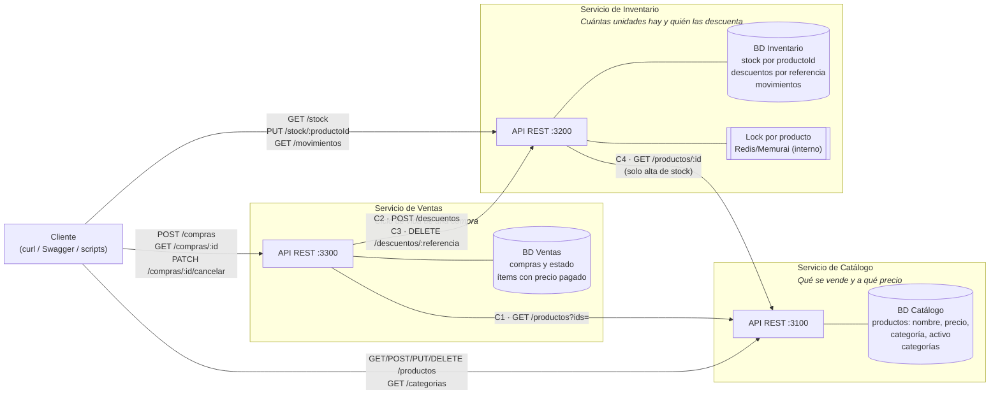

# Diagrama de arquitectura propuesta

> Corresponde a la sección 11 del TP (entregable 15). Representa las decisiones de
> [`04-microservicios.md`](./04-microservicios.md), [`05-propiedad-datos.md`](./05-propiedad-datos.md)
> y [`06-comunicaciones.md`](./06-comunicaciones.md).

## Cómo leer el diagrama

| Elemento | Significado |
|---|---|
| Recuadro grande | Un microservicio con su responsabilidad en una frase |
| Cilindro | Base de datos propia del servicio. Ningún otro servicio la accede |
| Flecha desde el Cliente | Punto de entrada público del servicio |
| Flecha entre servicios | Llamada HTTP/REST síncrona en el sentido de la flecha. El código `C1`–`C4` es la fila de la [matriz de comunicaciones](./06-comunicaciones.md#62-matriz-de-comunicaciones) |

## Decisiones que muestra

- **Las dependencias forman un grafo sin ciclos:** Ventas → Catálogo, Ventas → Inventario
  e Inventario → Catálogo. Catálogo no depende de nadie, así que se puede desplegar y
  probar solo.
- **No hay API Gateway en esta etapa.** Cada servicio expone su API directamente. Un
  punto de entrada único (un solo puerto público, autenticación centralizada,
  redirección al Leader) se evaluará en un TP posterior.
- **La replicación con Raft del TP4 no aparece como servicio** porque es infraestructura,
  no una responsabilidad de negocio. Cada servicio puede correr como su propio cluster
  Raft de 3 nodos detrás de su API, y eso no cambia ningún contrato. Por ejemplo, un
  follower de Inventario que responde `421` o `503` es, para Ventas, "Inventario no
  disponible".
- **El lock de Redis/Memurai pasa a ser interno de Inventario.** Hoy lo toma el
  controller de productos. En la propuesta solo lo conoce el dueño del stock.
- **Los puertos 3100/3200/3300 son de referencia:** no coinciden con los 3001–3003 de los
  nodos Raft actuales para no confundir "nodo" con "servicio".

## Control de coherencia

| Elemento del diagrama | Debe coincidir con | ✔ |
|---|---|---|
| Cada servicio y su frase de responsabilidad | Fichas §4.2 de [`04-microservicios.md`](./04-microservicios.md) | ✅ |
| Cada base de datos y sus datos | "Datos propios" de las fichas y [matriz de propiedad](./05-propiedad-datos.md) | ✅ con la matriz · ✅ con las fichas |
| Cada flecha entre servicios | Una fila de la matriz de comunicaciones (C1–C4), y viceversa | ✅ |
| El sentido de cada flecha | "Dependencias" de la ficha del servicio de origen | ✅ |
| Cada flecha desde el cliente | Endpoints de las fichas | ✅ |
| No hay flechas a la base de **otro** servicio | Regla de diseño del TP | ✅ |

Los controles contra las fichas de la Parte 2 se completaron en la ratificación del TP6
([`08-ratificacion-tp6.md`](./08-ratificacion-tp6.md) §8.6).
