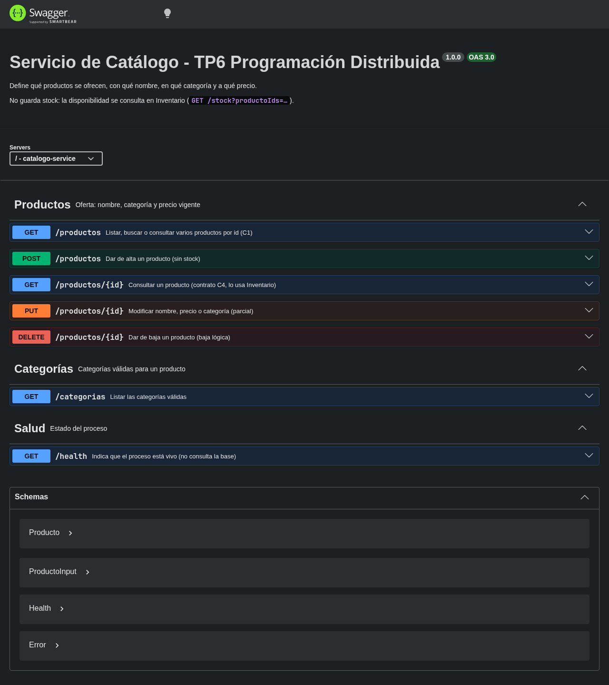
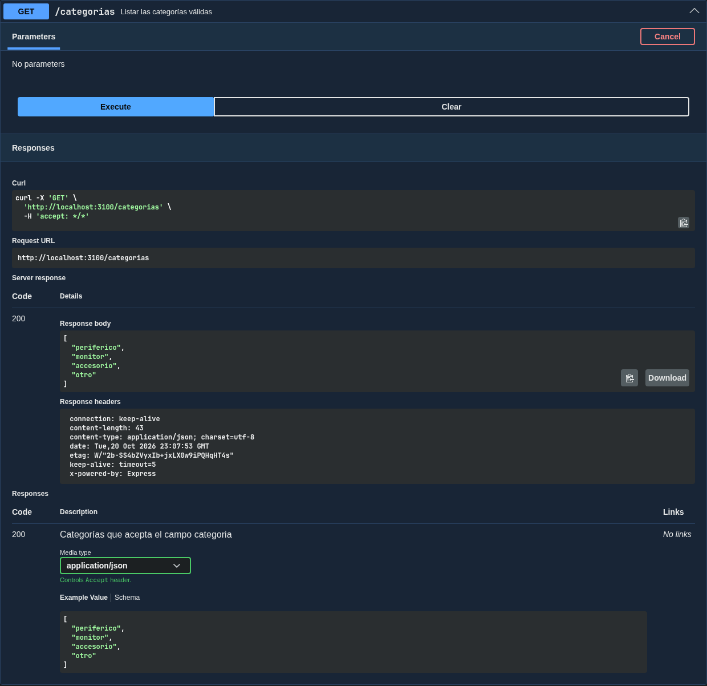

# Swagger

**Objetivo:** cada servicio documenta en `/api-docs` exactamente lo que implementa, incluidos
los contratos C1–C4 con sus respuestas.

| Servicio | URL | Contratos que documenta |
|---|---|---|
| Catálogo | <http://localhost:3100/api-docs> | C1 `GET /productos?ids=…` · C4 `GET /productos/:id` |
| Inventario | <http://localhost:3201/api-docs> | C2 `POST /descuentos` · C3 `DELETE /descuentos/:referencia` |
| Ventas | <http://localhost:3300/api-docs> | — (es consumidor) |

Pasos: abrir cada URL, ejecutar "Try it out" en un endpoint de cada servicio (por ejemplo
`GET /categorias` en Catálogo) y verificar que la respuesta coincida con la documentada.

```bash
curl -s http://localhost:3100/api-docs.json | node -e "process.stdin.on('data',d=>console.log(Object.keys(JSON.parse(d).paths)))"
```

## Salida obtenida

Corrida del 2026-10-20 en un clon limpio de la rama `docs/tp6-deployment` (commit `79b2e3a`), antes del merge a `main`. Cubre Catálogo; Inventario y Ventas todavía no tienen Dockerfile. **Se repite sobre `main` con los tres servicios antes del tag `tp6-entrega`.**

Endpoints documentados por Catálogo, con sus códigos de respuesta:

```text
$ curl -s http://localhost:3100/api-docs.json   (listado de paths, métodos y respuestas)
GET     /health          200 - Indica que el proceso está vivo (no consulta la base)
GET     /productos       200 400 503 - Listar, buscar o consultar varios productos por id (C1)
POST    /productos       201 400 409 503 - Dar de alta un producto (sin stock)
GET     /productos/{id}  200 400 404 503 - Consultar un producto (contrato C4, lo usa Inventario)
PUT     /productos/{id}  200 400 404 409 503 - Modificar nombre, precio o categoría (parcial)
DELETE  /productos/{id}  204 400 404 503 - Dar de baja un producto (baja lógica)
GET     /categorias      200 - Listar las categorías válidas
```

Vista general de <http://localhost:3100/api-docs>:



"Try it out" → "Execute" en `GET /categorias`: responde `200` con la lista documentada.



**Resultado:** ✅ Catálogo documenta exactamente los 7 endpoints que implementa, incluidos C1 (`GET /productos?ids=…`) y C4 (`GET /productos/{id}`) con sus respuestas, y "Try it out" funciona contra el servicio en Compose. Inventario (C2, C3) y Ventas: pendiente.
